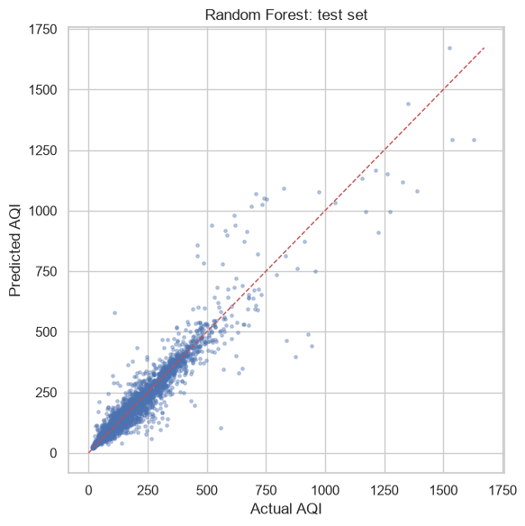
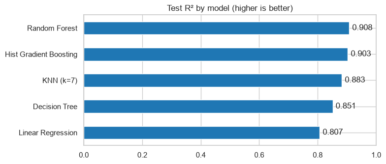
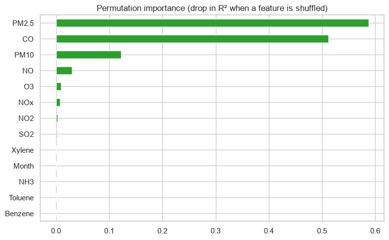
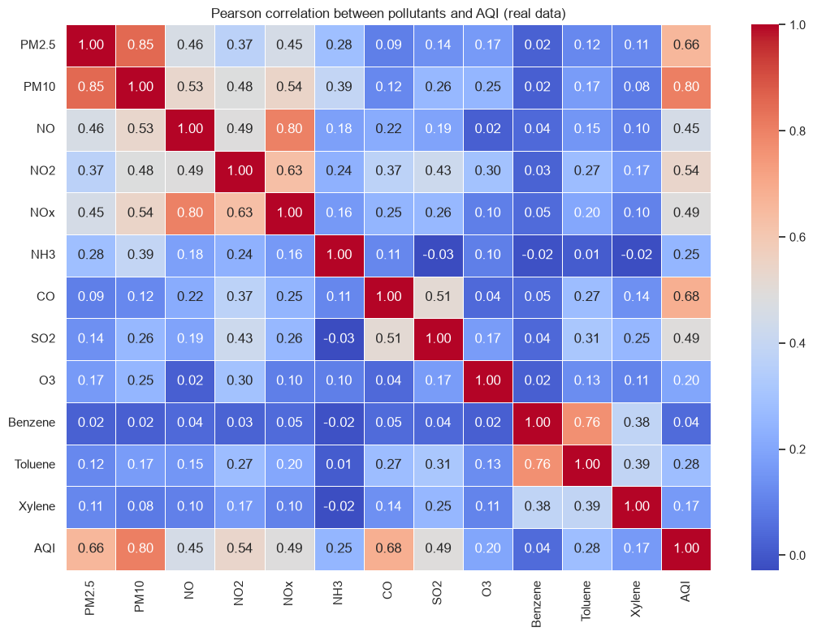
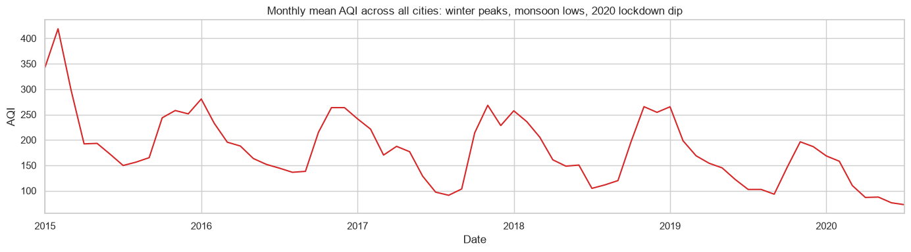

# Air Quality Index (AQI) Prediction – India 2015–2020

[](https://github.com/MohansaiPotnuru/Air-Quality-Prediction-by-AICTE/actions/workflows/notebook.yml)

Machine-learning model that predicts the daily **Air Quality Index** of Indian cities from pollutant concentrations. I built it during the **AICTE Cycle-4** internship.

**Best model:** Random Forest. **R² = 0.91**, **MAE ≈ 21 AQI points** on 4,970 held-out days. AQI category correct **80 %** of the time.



## Dataset

[`data/city_day.csv`](data/city_day.csv) contains daily readings from the Central Pollution Control Board (CPCB), from the public *Air Quality Data in India (2015–2020)* dataset.

| | |
|---|---|
| Rows | 29,531 days (24,850 with an AQI value) |
| Cities | 26 |
| Period | 2015-01-01 → 2020-07-01 |
| Features | PM2.5, PM10, NO, NO2, NOx, NH3, CO, SO2, O3, Benzene, Toluene, Xylene |
| Target | `AQI` (and the derived `AQI_Bucket`: Good … Severe) |

## Method

All of this is in [`AQI_Prediction.ipynb`](AQI_Prediction.ipynb).

1. **Cleaning:** drop rows with no AQI target. There are no duplicate rows.
2. **EDA:** AQI distribution, city ranking, monthly trend, correlation heatmap.
3. **Features:** the 12 pollutants plus the calendar month, for seasonality.
4. **Split:** random 80 / 20 train/test. A second, time-based split trains on 2015–2019 and tests on 2020.
5. **Pre-processing inside scikit-learn pipelines:** median imputation and scaling are fitted on the training data only, so there's no test-set leakage.
6. **Models:** Linear Regression, KNN, Decision Tree, Random Forest, Histogram Gradient Boosting.
7. **Evaluation:** R², RMSE, MAE, permutation feature importance, and the accuracy of the predicted AQI category.

## Results

**Random 80/20 split** (19,880 train / 4,970 test rows):

| Model | Train R² | Test R² | Test RMSE | Test MAE |
|---|---|---|---|---|
| **Random Forest** | 0.975 | **0.908** | **41.1** | **20.7** |
| Hist Gradient Boosting | 0.948 | 0.903 | 42.1 | 21.2 |
| KNN (k = 7) | 0.912 | 0.883 | 46.3 | 23.8 |
| Decision Tree | 0.970 | 0.851 | 52.2 | 25.0 |
| Linear Regression | 0.858 | 0.807 | 59.4 | 31.2 |

**Time-based split** (train 2015–2019, test 2020): Gradient Boosting R² = 0.912 and Random Forest R² = 0.905. The model still works on a year it has never seen.

| Model comparison | Feature importance |
|---|---|
|  |  |

| Correlation heatmap | Monthly mean AQI |
|---|---|
|  |  |

**Key findings**

- **PM2.5, CO and PM10** carry most of the predictive signal. That matches the CPCB definition, where AQI is the worst pollutant sub-index.
- Ahmedabad, Delhi, Patna, Gurugram and Lucknow have the highest mean AQI.
- AQI follows a strong seasonal cycle: winter peaks, monsoon lows, and a visible drop during the 2020 lockdown.
- Tree ensembles clearly beat linear regression because the AQI formula is non-linear.

## Run it

```sh
git clone https://github.com/MohansaiPotnuru/Air-Quality-Prediction-by-AICTE.git
cd Air-Quality-Prediction-by-AICTE
pip install -r requirements.txt
jupyter notebook AQI_Prediction.ipynb
```

A full run takes a few minutes on a laptop, mostly Random Forest training.

## Repository layout

```text
├── AQI_Prediction.ipynb   # Final, corrected end-to-end notebook (run this)
├── data/city_day.csv      # Dataset
├── images/                # Figures exported from the notebook
├── archive/               # Original weekly internship notebooks (kept for reference)
└── requirements.txt
```

## Corrections to the original notebooks

The weekly notebooks in `archive/` are kept unchanged as a record of the internship. The final notebook fixes these issues in them:

| Issue in the original | Effect | Fix |
|---|---|---|
| The Week-3 notebook overwrote `df` with a hand-typed 7-row table of *summary statistics* before modelling | All models were trained on **5 rows** and tested on **2**, so the reported scores (for example RF R² 0.81) meant nothing | Train on the real 24,850 rows |
| Missing `SO2` filled with the O3 mean, and `O3` with an unrelated value | Wrong values in the data | Median imputation per column, inside the pipeline |
| Imputation, outlier clipping and scaling fitted on the full dataset | Test-set information leaked into training | Fit all pre-processing on the training split only |
| The AQI **target** itself was outlier-clipped and standard-scaled | Extreme pollution days, the ones that matter most, were removed. Errors were reported in scaled units | Use raw AQI and report errors in AQI points |
| Correlation heatmap drawn from `describe()` statistics | The heatmap didn't show the real correlations | Correlations computed on the actual data |
| `pd.read_csv('air quality data.CSV')` while the file was `.csv` | Only worked on case-insensitive file systems (Windows) | Data moved to `data/city_day.csv` |

## Possible extensions

- Lag features (yesterday's AQI and pollutants) and weather data.
- Time-series cross-validation and hyperparameter tuning.
- A Streamlit dashboard or REST API serving the trained model.

## Acknowledgements

- **AICTE** internship programme (Cycle 4).
- Data: Central Pollution Control Board (CPCB), India, via the public *Air Quality Data in India* dataset.

## License

The code and notebooks are released under the [MIT License](LICENSE). The dataset in `data/` comes from a third party and is not covered by that licence.
